 

   

<!-- PROCS:START -->

<code>▸ ps aux</code> — open a process (public repos)
 

| state | repo | lang | commits (12 mo) | last push |
|:-:|---|---|--:|--:|
| ⚫ Z | [`hsd-mtu-site`](https://github.com/mustafazahter/hsd-mtu-site) | TypeScript | 66 | 203d03h ago |
| ⚫ Z | [`VectorTwin`](https://github.com/mustafazahter/VectorTwin) | Python | 38 | 105d03h ago |
| ⚫ Z | [`ai-cv-maker`](https://github.com/mustafazahter/ai-cv-maker) | TypeScript | 34 | 263d03h ago |
| 🟡 S | [`c-sharp-oop-masterclass`](https://github.com/mustafazahter/c-sharp-oop-masterclass) | TypeScript | 15 | 60d07h ago |
| 🟡 S | [`algo-lab`](https://github.com/mustafazahter/algo-lab) | JavaScript | 15 | 84d00h ago |
| ⚫ Z | [`gomulu-sistemler-ve-pic-programlama`](https://github.com/mustafazahter/gomulu-sistemler-ve-pic-programlama) | TypeScript | 11 | 160d11h ago |
| 🟢 R | [`mustafazahter`](https://github.com/mustafazahter/mustafazahter) | - | 6 | 0h00m ago |
| ⚫ Z | [`bilgisayar-mimarisi-notlari`](https://github.com/mustafazahter/bilgisayar-mimarisi-notlari) | HTML | 3 | 359d08h ago |
| 🟡 S | [`komuta-n8n-template`](https://github.com/mustafazahter/komuta-n8n-template) | Dockerfile | 0 | 77d06h ago |
| ⚫ Z | [`circor_proje`](https://github.com/mustafazahter/circor_proje) | Jupyter Notebook | 0 | 567d06h ago |
| ⚫ Z | [`disease-diagnosis-with-heart-sound`](https://github.com/mustafazahter/disease-diagnosis-with-heart-sound) | Python | 0 | 571d02h ago |
| ⚫ Z | [`deneme`](https://github.com/mustafazahter/deneme) | - | 0 | 949d13h ago |
| ⚫ Z | [`android`](https://github.com/mustafazahter/android) | - | 0 | 3711d03h ago |

<!-- PROCS:END -->

<!-- STACK:START -->

<code>▸ ls ~/stack</code> — click a folder to open it
 

<code>📁 ai/</code> 5 tools

    

<code>📁 lang/</code> 9 tools

        

<code>📁 web+mobile/</code> 6 tools

     

<code>📁 cloud+ops/</code> 6 tools

     

<code>📁 data/</code> 4 tools

   

<code>📁 design/</code> 4 tools

   

<!-- STACK:END -->

 

<!-- GAME:START -->

You play <b>White</b> against <code>zahter.bot</code>. Click a move below, then press <b>Submit new issue</b>. The bot replies in about 30 seconds and the board updates for everyone.

<b>♙ your move — 20 legal moves</b> (click one)

| piece | moves |
|:--|:--|
| ♘ `b1` | [`Na3`](https://github.com/mustafazahter/mustafazahter/issues/new?title=chess%7Cmove%7Cb1a3&body=Just%20press%20%22Submit%20new%20issue%22.%20The%20bot%20plays%20your%20move%2C%20answers%20as%20Black%20and%20updates%20the%20board%20in%20~30s.) · [`Nc3`](https://github.com/mustafazahter/mustafazahter/issues/new?title=chess%7Cmove%7Cb1c3&body=Just%20press%20%22Submit%20new%20issue%22.%20The%20bot%20plays%20your%20move%2C%20answers%20as%20Black%20and%20updates%20the%20board%20in%20~30s.) |
| ♘ `g1` | [`Nf3`](https://github.com/mustafazahter/mustafazahter/issues/new?title=chess%7Cmove%7Cg1f3&body=Just%20press%20%22Submit%20new%20issue%22.%20The%20bot%20plays%20your%20move%2C%20answers%20as%20Black%20and%20updates%20the%20board%20in%20~30s.) · [`Nh3`](https://github.com/mustafazahter/mustafazahter/issues/new?title=chess%7Cmove%7Cg1h3&body=Just%20press%20%22Submit%20new%20issue%22.%20The%20bot%20plays%20your%20move%2C%20answers%20as%20Black%20and%20updates%20the%20board%20in%20~30s.) |
| ♙ `a2` | [`a3`](https://github.com/mustafazahter/mustafazahter/issues/new?title=chess%7Cmove%7Ca2a3&body=Just%20press%20%22Submit%20new%20issue%22.%20The%20bot%20plays%20your%20move%2C%20answers%20as%20Black%20and%20updates%20the%20board%20in%20~30s.) · [`a4`](https://github.com/mustafazahter/mustafazahter/issues/new?title=chess%7Cmove%7Ca2a4&body=Just%20press%20%22Submit%20new%20issue%22.%20The%20bot%20plays%20your%20move%2C%20answers%20as%20Black%20and%20updates%20the%20board%20in%20~30s.) |
| ♙ `b2` | [`b3`](https://github.com/mustafazahter/mustafazahter/issues/new?title=chess%7Cmove%7Cb2b3&body=Just%20press%20%22Submit%20new%20issue%22.%20The%20bot%20plays%20your%20move%2C%20answers%20as%20Black%20and%20updates%20the%20board%20in%20~30s.) · [`b4`](https://github.com/mustafazahter/mustafazahter/issues/new?title=chess%7Cmove%7Cb2b4&body=Just%20press%20%22Submit%20new%20issue%22.%20The%20bot%20plays%20your%20move%2C%20answers%20as%20Black%20and%20updates%20the%20board%20in%20~30s.) |
| ♙ `c2` | [`c3`](https://github.com/mustafazahter/mustafazahter/issues/new?title=chess%7Cmove%7Cc2c3&body=Just%20press%20%22Submit%20new%20issue%22.%20The%20bot%20plays%20your%20move%2C%20answers%20as%20Black%20and%20updates%20the%20board%20in%20~30s.) · [`c4`](https://github.com/mustafazahter/mustafazahter/issues/new?title=chess%7Cmove%7Cc2c4&body=Just%20press%20%22Submit%20new%20issue%22.%20The%20bot%20plays%20your%20move%2C%20answers%20as%20Black%20and%20updates%20the%20board%20in%20~30s.) |
| ♙ `d2` | [`d3`](https://github.com/mustafazahter/mustafazahter/issues/new?title=chess%7Cmove%7Cd2d3&body=Just%20press%20%22Submit%20new%20issue%22.%20The%20bot%20plays%20your%20move%2C%20answers%20as%20Black%20and%20updates%20the%20board%20in%20~30s.) · [`d4`](https://github.com/mustafazahter/mustafazahter/issues/new?title=chess%7Cmove%7Cd2d4&body=Just%20press%20%22Submit%20new%20issue%22.%20The%20bot%20plays%20your%20move%2C%20answers%20as%20Black%20and%20updates%20the%20board%20in%20~30s.) |
| ♙ `e2` | [`e3`](https://github.com/mustafazahter/mustafazahter/issues/new?title=chess%7Cmove%7Ce2e3&body=Just%20press%20%22Submit%20new%20issue%22.%20The%20bot%20plays%20your%20move%2C%20answers%20as%20Black%20and%20updates%20the%20board%20in%20~30s.) · [`e4`](https://github.com/mustafazahter/mustafazahter/issues/new?title=chess%7Cmove%7Ce2e4&body=Just%20press%20%22Submit%20new%20issue%22.%20The%20bot%20plays%20your%20move%2C%20answers%20as%20Black%20and%20updates%20the%20board%20in%20~30s.) |
| ♙ `f2` | [`f3`](https://github.com/mustafazahter/mustafazahter/issues/new?title=chess%7Cmove%7Cf2f3&body=Just%20press%20%22Submit%20new%20issue%22.%20The%20bot%20plays%20your%20move%2C%20answers%20as%20Black%20and%20updates%20the%20board%20in%20~30s.) · [`f4`](https://github.com/mustafazahter/mustafazahter/issues/new?title=chess%7Cmove%7Cf2f4&body=Just%20press%20%22Submit%20new%20issue%22.%20The%20bot%20plays%20your%20move%2C%20answers%20as%20Black%20and%20updates%20the%20board%20in%20~30s.) |
| ♙ `g2` | [`g3`](https://github.com/mustafazahter/mustafazahter/issues/new?title=chess%7Cmove%7Cg2g3&body=Just%20press%20%22Submit%20new%20issue%22.%20The%20bot%20plays%20your%20move%2C%20answers%20as%20Black%20and%20updates%20the%20board%20in%20~30s.) · [`g4`](https://github.com/mustafazahter/mustafazahter/issues/new?title=chess%7Cmove%7Cg2g4&body=Just%20press%20%22Submit%20new%20issue%22.%20The%20bot%20plays%20your%20move%2C%20answers%20as%20Black%20and%20updates%20the%20board%20in%20~30s.) |
| ♙ `h2` | [`h3`](https://github.com/mustafazahter/mustafazahter/issues/new?title=chess%7Cmove%7Ch2h3&body=Just%20press%20%22Submit%20new%20issue%22.%20The%20bot%20plays%20your%20move%2C%20answers%20as%20Black%20and%20updates%20the%20board%20in%20~30s.) · [`h4`](https://github.com/mustafazahter/mustafazahter/issues/new?title=chess%7Cmove%7Ch2h4&body=Just%20press%20%22Submit%20new%20issue%22.%20The%20bot%20plays%20your%20move%2C%20answers%20as%20Black%20and%20updates%20the%20board%20in%20~30s.) |

<!-- GAME:END -->

<code>$ crontab -l</code> → this page re-renders itself every day from the GitHub API · plain SVG + CSS, zero JavaScript · <a href="scripts">source</a>

